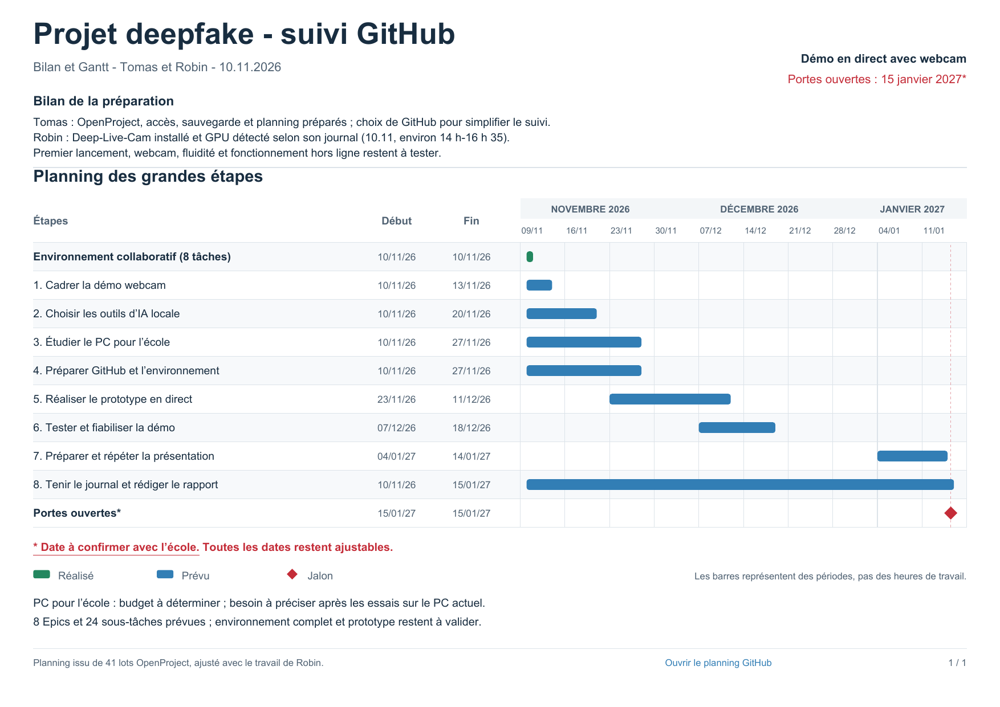

# DeepFake — projet scolaire

Nous sommes **Tomas et Robin**. Nous préparons une démonstration de deepfake en direct par webcam, avec un traitement IA exécuté localement sur un PC. L’objectif est de montrer le fonctionnement de cette technologie, ses possibilités et ses limites à partir de participants consentants. Le caractère synthétique des images sera annoncé clairement.

La présentation est envisagée pour les portes ouvertes du **15 janvier 2027, date à confirmer avec l’école**.

## Où en sommes-nous ?

Au 10 novembre 2026, le projet est en phase de préparation : un premier planning, une recherche d’outils et un inventaire du matériel ont été réalisés. OpenProject a d’abord été mis en place ; nous avons ensuite choisi GitHub pour réunir le suivi du travail, la documentation et le futur code.

Robin a terminé une première installation de **Deep-Live-Cam** sur son PC. Son journal rapporte la présence des deux modèles ONNX et la détection du GPU par PyTorch et ONNX Runtime. **Le premier lancement avec webcam, les performances et le fonctionnement hors ligne restent à tester ; aucun prototype complet n’est encore validé.** Ces contrôles de détection ne suffisent pas à valider toute la chaîne de traitement. Le budget d’un éventuel PC prêté ou fourni par l’école reste à déterminer.

## Suivre le projet

- [Planning et tableau de suivi](https://github.com/users/tomyrms/projects/3)
- [Issues : phases, tâches et décisions](https://github.com/tomyrms/DeepFake/issues)
- [Journal de travail](docs/journal/README.md)
- [Comment on travaille à deux](docs/organisation.md)
- [Première séance — 10 novembre 2026](docs/journal/2026-11-10.md)
- [Recherche sur les outils et le matériel](docs/recherche-materiel.md)
- [Synthèse et Gantt en PDF](docs/exports/synthese-et-gantt.pdf)

Le planning est organisé en huit phases : cadrage, choix des outils, étude du PC, préparation de l’environnement, prototype, tests, présentation et rapport. Les dates sont provisoires et seront ajustées selon les essais et le matériel disponible.

Nous privilégions les outils ouverts et une installation reproductible. La licence du logiciel et celles de ses modèles seront examinées séparément avant de retenir une solution.

## Prochain travail

Préciser le scénario webcam, tester le premier lancement de Deep-Live-Cam et mesurer les performances sur le PC disponible. FaceFusion reste une alternative à comparer si nécessaire. Les mesures obtenues serviront à préparer une demande de matériel à l’école. Les professeurs pourront recevoir le journal, le bilan et le planning en PDF.
