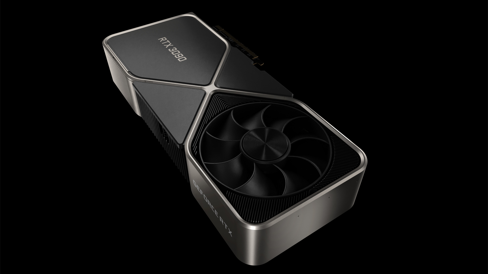
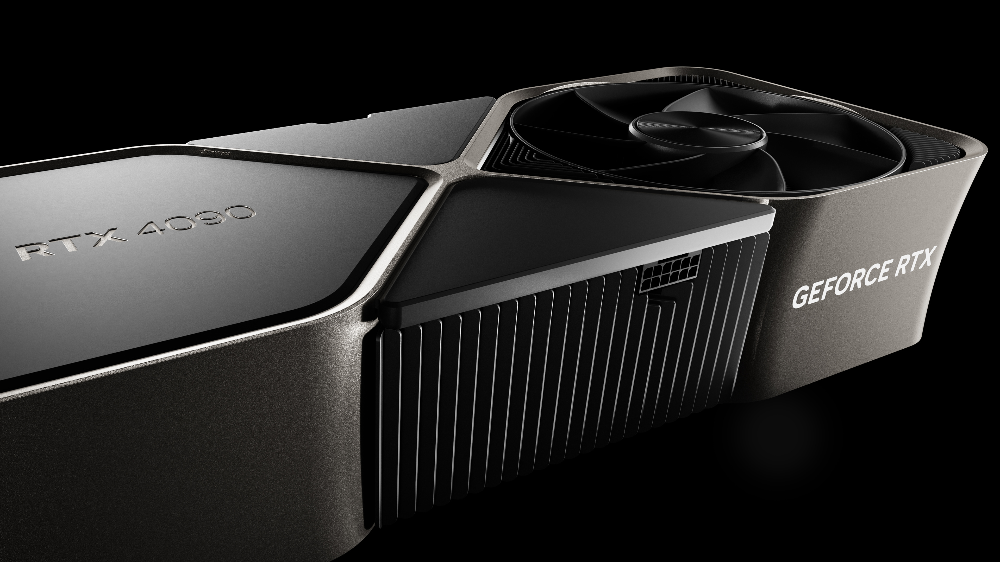
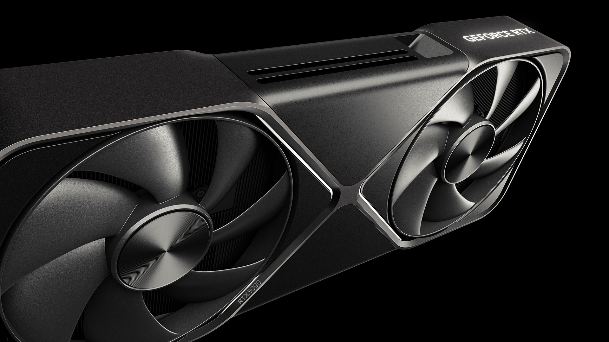
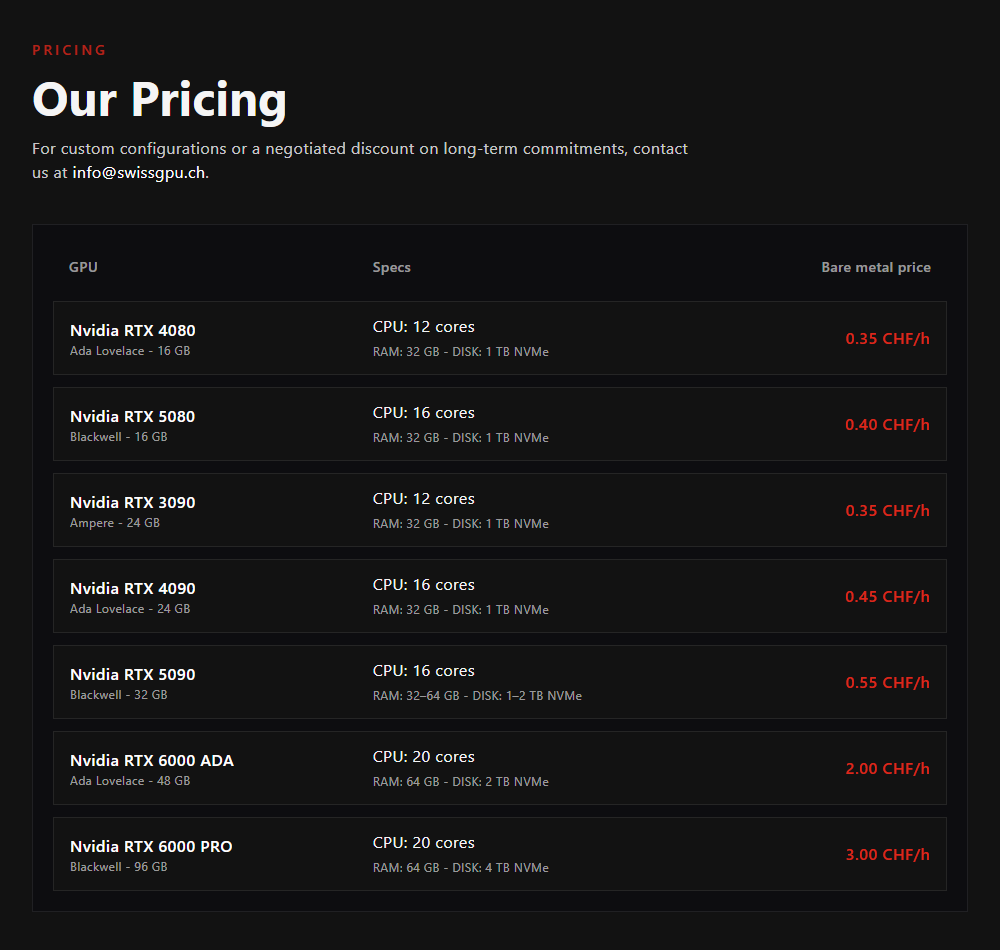
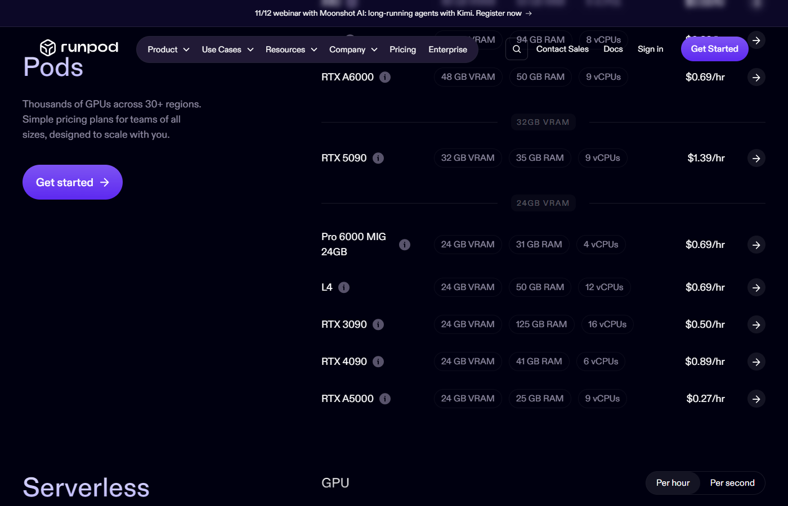
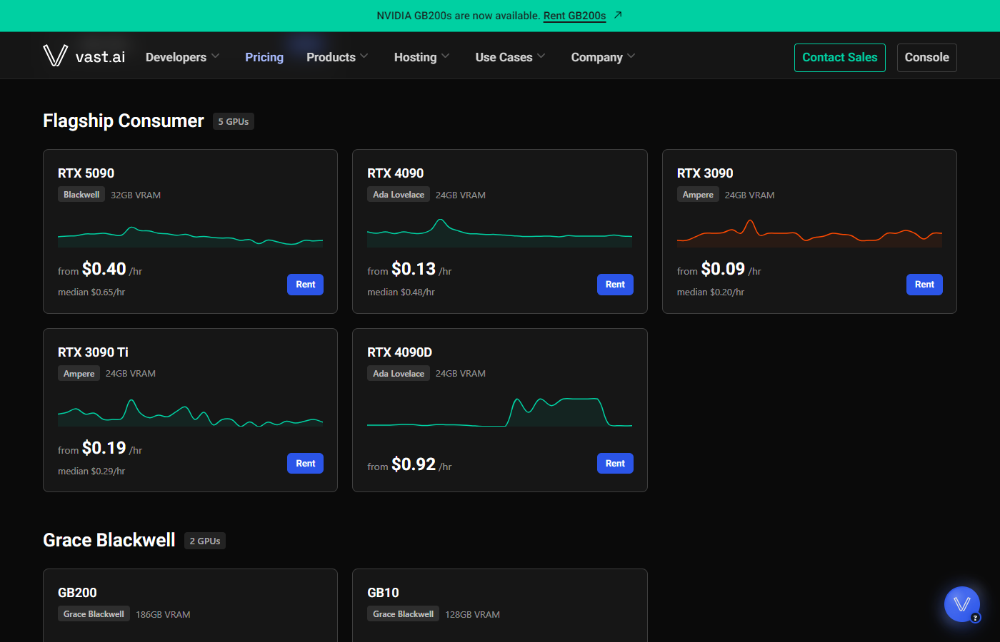

# Choix de JoyAI-Video-Edit et du GPU

Tomas et Robin, mise à jour du 16 novembre 2026.

Nous avons retenu JoyAI-Video-Edit et prévoyons de l’installer sur une RTX 5090 de 32 Go de VRAM louée chez SwissGPU. Le modèle dispose d’un profil de déploiement pour cette carte, que nous voulons essayer avant d’acheter du matériel.

## Ce que nous voulons obtenir

La démonstration doit transformer la tête entière, cheveux compris, tout en suivant les mouvements de la personne.

Notre cible pour le prototype est **840 × 480 pixels à environ 24 images/s**, le profil annoncé sur RTX 5090 dans le [guide de JoyAI](https://github.com/jd-opensource/JoyAI-Video-Edit/blob/d5d459996b9db56ebbec611ae5d23e3d174c1a73/DEPLOYMENT.md). L’essai devra confirmer ce débit et le rendu des cheveux et du visage en mouvement.

## Les trois solutions étudiées

| Solution | Fonctionnement et taille des modèles | Notre choix |
|---|---|---|
| 1. JoyAI-Video-Edit | Édition générative d’un flux vidéo à partir d’une instruction et, si nécessaire, d’une image de référence. Le transformeur de diffusion compte **16 milliards de paramètres**. Le système comprend aussi un encodeur multimodal MiMo-VL-7B et un encodeur/décodeur vidéo causal, appelé VAE. | Retenu : il permet des transformations plus larges que le visage, dispose d’une démo que nous avons essayée et d’un profil RTX 5090 documenté. |
| 2. Wan 2.1 avec StreamDiffusionV2 | Wan fournit les modèles génératifs vidéo de **1,3 ou 14 milliards de paramètres**. StreamDiffusionV2 organise leur exécution en continu avec des versions causales et distillées. | Piste de comparaison. L’installation et les réglages dépendent de la variante choisie ; nous n’avons pas encore validé son rendu pour notre démonstration. |
| 3. Deep-Live-Cam | Application utilisant les modèles d’analyse faciale d’InsightFace, INSwapper pour échanger le visage et GFPGAN pour le restaurer, en option. Aucun total de paramètres n’est publié pour l’application dans les sources consultées. | Écarté pour notre objectif : il conserve les cheveux et le reste de la tête de la personne filmée. |

Sources : [JoyAI-Video-Edit](https://github.com/jd-opensource/JoyAI-Video-Edit), [Wan 2.1](https://github.com/Wan-Video/Wan2.1), [StreamDiffusionV2](https://github.com/chenfengxu714/StreamDiffusionV2), [Deep-Live-Cam](https://github.com/hacksider/Deep-Live-Cam).

Nous installerons la version 1.1 du 9 novembre, qui améliore selon ses auteurs le remplacement de personnage guidé par une image. Nous avons essayé la démo sur Hugging Face ; aucun test sur notre future RTX 5090 n’a encore été réalisé. [Annonce de la version 1.1](https://github.com/jd-opensource/JoyAI-Video-Edit/blob/d5d459996b9db56ebbec611ae5d23e3d174c1a73/README.md)

Un mainteneur de StreamDiffusionV2 rapporte que la variante 1,3B utilise presque les 24 Go d’une RTX 4090. Ce relevé dépend du cache et des réglages ; il ne s’applique pas au modèle 14B. [Échange avec le mainteneur](https://github.com/chenfengxu714/StreamDiffusionV2/issues/16#issuecomment-3707884543)

Sur notre PC, Deep-Live-Cam était très lent, saccadé et de qualité insuffisante. Nous n’avons pas relevé de débit ni de délai chiffré.

## Ce que JoyAI demande au GPU

Ces débits sont annoncés par les auteurs et précèdent la version 1.1. Nous devons les vérifier sur notre installation.

| GPU | Résolution | Débit annoncé |
|---|---:|---:|
| RTX 5090, 32 Go | 840 × 480 | 24 images/s |
| RTX PRO 6000 Blackwell, 96 Go | 1 248 × 720 | 16 images/s |
| NVIDIA B200 | 1 248 × 720 | Environ 30 images/s |

Source : [profils de déploiement JoyAI](https://github.com/jd-opensource/JoyAI-Video-Edit/blob/d5d459996b9db56ebbec611ae5d23e3d174c1a73/DEPLOYMENT.md).

Le profil vidéo à 840 × 480 indique environ **21,5 Gio de VRAM occupés en continu et 28 Gio au pic**. Il utilise le mode mémoire réduite, des poids compressés en FP8 et le transfert de l’encodeur entre la RAM et le GPU. L’amélioration locale des instructions par un modèle supplémentaire est désactivée. Les 32 Go supposent donc ces optimisations. Le guide prévoit Linux et un environnement CUDA compatible avec la carte.

Notre RTX 4070 Laptop dispose de 8 Go de VRAM, loin de ce pic de mémoire. Les RTX 3090 et 4090 ont 24 Go : elles demanderaient d’autres adaptations pour ce profil. La RTX 5090 nous permet de commencer avec une configuration déjà décrite par les auteurs.

Le débit en images/s ne mesure pas le retard de la webcam. Le traitement fonctionne par blocs d’images ; il faut aussi compter le transfert réseau et l’affichage. Nous mesurerons ce délai depuis l’école.

## Pourquoi louer la RTX 5090 chez SwissGPU

L’offre SwissGPU annonce 16 cœurs CPU, 32 à 64 Go de RAM et 32 Go de VRAM. Nous viserons 64 Go de RAM, selon disponibilité, pour les composants déchargés du GPU. C’est notre marge de travail ; le guide JoyAI ne fixe pas de minimum global de RAM ou de cœurs CPU. [Offre RTX 5090](https://www.swissgpu.ch/gpus/rtx-5090)

| RTX 3090, 24 Go | RTX 4090, 24 Go | RTX 5090, 32 Go |
|---|---|---|
|  |  |  |
| 0,35 CHF/h | 0,40 CHF/h | 0,50 CHF/h |
| Crédit : NVIDIA. [Page produit](https://www.nvidia.com/en-us/geforce/graphics-cards/30-series/rtx-3090-3090ti/) · [Image originale](https://www.nvidia.com/content/dam/en-zz/Solutions/geforce/ampere/rtx-3090/geforce-rtx-3090-product-gallery-full-screen-3840-2.jpg) | Crédit : NVIDIA. [Page produit](https://www.nvidia.com/en-us/geforce/graphics-cards/40-series/rtx-4090/) · [Image originale](https://images.nvidia.com/aem-dam/Solutions/geforce/ada/rtx-4090/geforce-rtx-4090-product-gallery-full-screen-3840-3.jpg) | Crédit : NVIDIA. [Page produit](https://www.nvidia.com/en-us/geforce/graphics-cards/50-series/rtx-5090/) · [Image originale](https://www.nvidia.com/content/dam/en-zz/Solutions/geforce/graphic-cards/50-series/rtx-5090/geforce-rtx-5090-gallery-shot-3-ari.jpg) |

Visuels constructeur ; le modèle de carte installé peut différer. [Tarifs SwissGPU](https://www.swissgpu.ch/api/v1/pricing) vérifiés le 16 novembre, hors électricité et frais.

La 5090 coûte 0,10 CHF/h de plus que la 4090, soit **1 CHF de plus sur 10 heures**, pour 8 Go de VRAM supplémentaires. Le pic mémoire publié par JoyAI justifie cet écart. La PRO 6000 coûte 1,80 CHF/h chez SwissGPU, soit 18 CHF pour 10 heures hors frais. Notre profil de test ne justifie pas ses 96 Go. La B200 serait une piste pour viser le 720p à 30 images/s, au-delà du premier prototype prévu.

Louer nous permet de vérifier le résultat avant d’acheter une carte et une machine compatible. Un prêt de l’école reste possible si le matériel convient. SwissGPU propose des serveurs dédiés en Suisse et une facturation en CHF ; le délai réel depuis l’école reste à tester. [SwissGPU](https://www.swissgpu.ch/about)

Source : [SwissGPU, tarifs](https://www.swissgpu.ch/pricing), capture du 13 novembre 2026. Les prix ont changé depuis cette capture : le calcul ci-dessous utilise ceux du 16 novembre.

Runpod et Vast.ai restent des alternatives. Pour comparer leur coût à SwissGPU, il faut tenir compte de la machine complète, des frais et de sa localisation.

| Runpod | Vast.ai |
|---|---|
|  |  |
| Source : [Runpod, tarifs](https://www.runpod.io/pricing). | Source : [Vast.ai, tarifs](https://vast.ai/pricing). |

Captures du 13 novembre 2026, avec des prix en dollars américains.

## Budget pour 10 heures

| Poste | Calcul | Coût |
|---|---|---:|
| Location RTX 5090 | 10 h × 0,50 CHF | 5,00 CHF |
| Une installation Linux | 1 × 0,50 CHF | 0,50 CHF |
| Électricité | Consommation en kWh × 0,32 CHF | Selon le relevé |
| Total hors options | 5,00 + 0,50 + électricité | **5,50 CHF + électricité** |

Le tarif est passé de 0,55 CHF/h le 13 novembre à 0,50 CHF/h le 16, soit 0,50 CHF de moins pour 10 heures. [Tarifs et frais SwissGPU](https://www.swissgpu.ch/pricing)

Le montant de 7,90 CHF relevé précédemment reste à identifier. S’il correspond à l’électricité seule, le total serait **5,50 + 7,90 = 13,40 CHF**. S’il s’agit déjà du total, il ne faut pas l’ajouter une seconde fois. Nous vérifierons le détail avant de lancer la location.

L’IPv4 partagé, s’il est nécessaire, ajoute 0,50 CHF par tranche de 24 heures commencée. Chaque réinstallation coûte aussi 0,50 CHF. À la fin du test, nous demanderons la fin de location et vérifierons l’arrêt de facturation : éteindre le serveur ne suffit pas. [Conditions de facturation](https://www.swissgpu.ch/pricing)

## Le premier essai

Nous installerons JoyAI-Video-Edit 1.1 avec le profil RTX 5090, puis testerons la webcam à 840 × 480 depuis le réseau de l’école. Nous relèverons le débit, le délai d’affichage, la mémoire utilisée et la consommation électrique. Le rendu de la tête et des cheveux doit rester cohérent quand la personne bouge.

Nous demandons le financement de cette séance après confirmation du coût, ainsi que l’accès au réseau de l’école, à une webcam et à un écran. Ces résultats permettront de décider si nous gardons cette installation pour la présentation.

[Documentation technique](README.md) · [Retour au projet](../../README.md)
