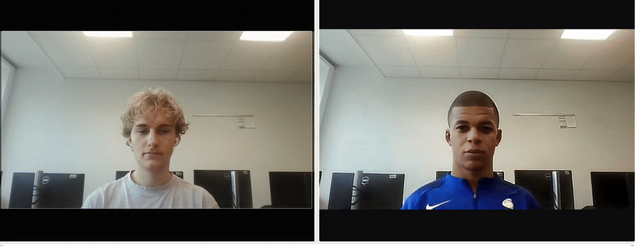

# Rapport d'installation et de tests : Deep-Live-Cam, JoyAI-Video-Edit, et Wan 2.1 avec StreamDiffusionV2

## 1. Résumé

| Outil                       | Rôle                                                                                  |
| --------------------------- | ------------------------------------------------------------------------------------- |
| Deep-Live-Cam               | Échange de visage en temps réel avec une seule photo source                           |
| Wan 2.1 + StreamDiffusionV2 | Transformation vidéo en direct de la webcam, guidée par un texte                      |
| JoyAI-Video-Edit            | Modification vidéo en temps réel guidée par un texte (testé en démo sur Hugging Face) |

Les trois outils sont gratuits et open source. Deep-Live-Cam et StreamDiffusionV2 tournent en local, sans rien envoyer sur Internet. JoyAI-Video-Edit, je l'ai seulement testé avec la démo Hugging Face, mais c'est lui que nous allons installer en local. Deep-Live-Cam s'installe sous Windows. StreamDiffusionV2 demande Linux, donc chez moi il tourne dans WSL2 (Ubuntu). Avec mes 8 Go de VRAM, il est à la limite de ce que ma carte supporte, et la mémoire a été mon plus gros problème.

## 2. Matériel et environnement

- PC portable sous Windows
- Carte graphique NVIDIA GeForce RTX 4070 portable, 8 Go de VRAM

## 3. Présentation des outils

### 3.1 Deep-Live-Cam

Deep-Live-Cam remplace mon visage sur la webcam par celui d'une photo, en temps réel et sans entraînement. Ce n'est pas un modèle d'IA générative, c'est un algorithme. Je l'ai choisi parmi quatre pistes, dont FaceFusion, parce qu'une seule photo suffit.


J'ai utilisé le dépôt officiel `github.com/hacksider/Deep-Live-Cam`.

### 3.2 Wan 2.1 avec StreamDiffusionV2

Wan 2.1 est un modèle ouvert d'Alibaba qui génère de la vidéo. Il existe en deux tailles, 1.3B et 14B, et on peut le lancer dans ComfyUI.

StreamDiffusionV2 se sert de Wan 2.1 pour transformer une vidéo en direct. Il prend le flux de ma webcam et le modifie selon un prompt.

Il lui faut Linux, une carte NVIDIA et les pilotes CUDA. Sous Windows, il faut donc passer par WSL2.

Sur la vidéo ci-dessous, on voit que ça rame et que ça plante souvent. Notre PC n'est pas assez puissant. J'avais aussi demandé la tête du footballeur Kylian Mbappé, et l'IA a complètement inventé le visage.


### 3.3 JoyAI-Video-Edit

JoyAI-Video-Edit est un modèle gratuit et open source de l'entreprise chinoise JD. On lui donne une vidéo et une consigne écrite, et il modifie la vidéo en direct. Le modèle est très gros (16 milliards de paramètres). Nous allons le faire tourner sur une RTX 5090, donc nous n'aurons sans doute pas la qualité annoncée par ses auteurs (720p à environ 30 images par seconde). Le modèle se télécharge sur Hugging Face et le code pour le lancer est sur GitHub.



## 4. Installation et limites

### 4.1 Deep-Live-Cam

#### Installation (Windows)

1. J'ai installé les prérequis avec `winget` : Python, Git, FFmpeg et les composants Visual Studio nécessaires.
2. J'ai cloné le dépôt officiel :
   ```
   git clone --depth 1 https://github.com/hacksider/Deep-Live-Cam.git
   cd Deep-Live-Cam
   ```
3. J'ai mis les deux modèles, `gfpgan-1024.onnx` et `inswapper_128_fp16.onnx` (environ 300 Mo chacun), dans le dossier `models`.
4. J'ai créé l'environnement virtuel Python avec une version que le README actuel accepte :
   ```
   py -3.14 -m venv venv
   venv\Scripts\activate
   pip install -r requirements.txt
   ```
   Si PowerShell refuse d'activer le venv, la commande `Set-ExecutionPolicy -Scope CurrentUser RemoteSigned` règle le problème.
5. J'ai configuré le GPU comme l'indique le README actuel :
   - CUDA Toolkit 12.8.0
   - cuDNN 8.9.7, en copiant ses fichiers dans le dossier de CUDA
   - PyTorch pour CUDA 12.8 : `pip install -U torch torchvision torchaudio --index-url https://download.pytorch.org/whl/cu128`
   - `pip uninstall onnxruntime onnxruntime-gpu`, puis `pip install onnxruntime-gpu==1.26.0`

Les premières instructions que j'avais (Python 3.10, anciens noms de modèles, CUDA 11.8) n'étaient plus à jour. Je les ai corrigées en relisant le README du dépôt.

Pour le lancer, il suffit de taper :

```
python run.py --execution-provider cuda
```

Dans l'interface, je choisis la photo du visage (Select a face), puis la webcam, et je clique sur Live. L'image met 10 à 30 secondes à apparaître.

Pour que ça ne plante pas sur mon portable, je dois le brancher au secteur, passer en mode performances, forcer `python.exe` sur la carte NVIDIA dans les paramètres graphiques de Windows et laisser la webcam en 720p.

#### Limites connues

L'outil remplace les traits du visage, mais pas les cheveux ni la forme de la tête. Le résultat dépend aussi de la lumière et de l'angle de la photo.

### 4.2 Wan 2.1 avec StreamDiffusionV2

#### Installation

1. J'ai installé WSL2 et Ubuntu avec `wsl --install -d Ubuntu` (PowerShell en administrateur), puis j'ai redémarré et créé un utilisateur Ubuntu.
2. Depuis Ubuntu, j'ai vérifié le GPU : `nvidia-smi` affiche bien la RTX 4070 (8 188 Mo).
3. Pour la suite, j'ai utilisé trois scripts que Claude m'a générés à partir du dépôt GitHub. Ils sont dans le dossier [`scripts/streamdiffusionv2`](../../scripts/streamdiffusionv2) du dépôt :
   - `1_installer_wsl.ps1` installe WSL2 et Ubuntu.
   - `2_setup_streamdiffusionv2.sh` installe Miniconda, crée l'environnement Python 3.10, clone le dépôt, installe le paquet, télécharge les modèles et installe Node.js 18.
   - `3_lancer_demo_webcam.sh` active l'environnement, télécharge le décodeur léger TAEHV, construit l'interface web, arrête les anciens processus et lance la démo.

#### Limites connues

C'est très lent. Après le lancement dans la page web, j'attendais 3 à 4 minutes avant de voir une image. Ensuite la vidéo ne bougeait plus, comme si l'outil avait planté. Les auteurs annoncent environ 61 images par seconde en 1.3B et 31 en 14B, mais sur des cartes bien plus puissantes que ma RTX 4070 portable. Chez moi, ce n'est pas du temps réel.

L'IA invente une partie de l'image. Deep-Live-Cam remplace seulement le visage, alors que StreamDiffusionV2 recrée toute l'image à partir de ma webcam et du prompt. Le visage, les cheveux, les vêtements et le fond peuvent donc changer d'une image à l'autre, et le résultat ne correspond pas toujours au prompt. Je ne peux pas vraiment choisir le visage obtenu.

### 4.3 JoyAI-Video-Edit

#### Test de la démo sur Hugging Face

Pour l'instant, je l'ai seulement testé avec la démo en ligne sur Hugging Face, dans le navigateur. Je ne l'ai pas encore installé sur mon PC.

#### Choix pour la suite

La démo nous a convaincus, donc nous allons installer JoyAI-Video-Edit en local. Comme ça, aucune donnée ne part sur Internet. C'est devenu notre piste prioritaire.

Nos PC n'ont que 8 Go de VRAM, ce qui est trop peu pour ce modèle. Le PC de la salle B203 que M. Guinchard nous a proposé a aussi 8 Go (RTX A1000), donc nous l'avons refusé. SwissGPU nous offre 10 heures sur une RTX 5090 de 32 Go, et c'est sur cette carte que nous allons l'installer et le tester.

## Sources

- Dépôt Deep-Live-Cam : https://github.com/hacksider/Deep-Live-Cam
- Dépôt StreamDiffusionV2 : https://github.com/chenfengxu714/StreamDiffusionV2
- Page du projet StreamDiffusionV2 : https://streamdiffusionv2.github.io
- Article : https://arxiv.org/abs/2511.07399
- Wan 2.1 : https://github.com/Wan-Video/Wan2.1
- Doc ComfyUI, Wan Video : https://docs.comfy.org/tutorials/video/wan/wan-video
- JoyAI-Video-Edit (Hugging Face) : https://huggingface.co/jdopensource/JoyAI-Video-Edit
- JoyAI-Video-Edit (GitHub) : https://github.com/jd-opensource/JoyAI-Video-Edit
- Claude Code utilisé pour générer les scripts d'installation : https://claude.com/claude-code
