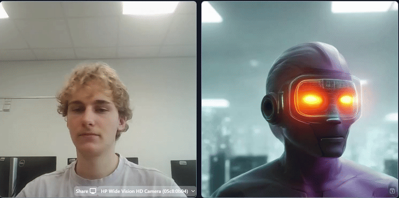

# Rapport d'installation et de tests : Deep-Live-Cam, Wan 2.1 avec StreamDiffusionV2, FasterLivePortrait, ComfyUI-LivePortraitKJ et JoyAI-Video-Edit

## 1. Résumé

| Outil                       | Rôle                                                                                  |
| --------------------------- | ------------------------------------------------------------------------------------- |
| Deep-Live-Cam               | Échange de visage en temps réel avec une seule photo source                           |
| Wan 2.1 + StreamDiffusionV2 | Transformation vidéo en direct de la webcam, guidée par un texte                      |
| FasterLivePortrait          | Animation d'une photo avec une vidéo ou la webcam, accélérée avec TensorRT            |
| ComfyUI-LivePortraitKJ      | Animation d'une photo avec les mouvements de ma webcam, dans ComfyUI                  |
| JoyAI-Video-Edit            | Modification vidéo en temps réel guidée par un texte (testé en démo sur Hugging Face) |

Les cinq outils sont gratuits et open source. Deep-Live-Cam, StreamDiffusionV2, FasterLivePortrait et ComfyUI-LivePortraitKJ tournent en local, sans rien envoyer sur Internet. JoyAI-Video-Edit, je l'ai seulement testé avec la démo Hugging Face, mais c'est lui que nous allons installer en local. Deep-Live-Cam s'installe sous Windows. StreamDiffusionV2 demande Linux, donc chez moi il tourne dans WSL2 (Ubuntu). Avec mes 8 Go de VRAM, il est à la limite de ce que ma carte supporte, et la mémoire a été mon plus gros problème. FasterLivePortrait et ComfyUI-LivePortraitKJ reposent tous les deux sur LivePortrait : ils fonctionnent sur mon PC, mais ils animent une photo au lieu de transformer la personne filmée.

## 2. Matériel et environnement

- PC portable sous Windows
- Carte graphique NVIDIA GeForce RTX 4070 portable, 8 Go de VRAM

## 3. Présentation des outils

### 3.1 Deep-Live-Cam

Deep-Live-Cam remplace mon visage sur la webcam par celui d'une photo, en temps réel et sans entraînement. Ce n'est pas un modèle d'IA générative, c'est un algorithme. Je l'ai choisi parmi quatre pistes, dont FaceFusion, parce qu'une seule photo suffit.


J'ai utilisé le dépôt officiel `github.com/hacksider/Deep-Live-Cam`.

### 3.2 Wan 2.1 avec StreamDiffusionV2

Wan 2.1 est un modèle ouvert d'Alibaba qui génère de la vidéo. Il existe en deux tailles, 1.3B et 14B, et on peut le lancer dans ComfyUI.

StreamDiffusionV2 se sert de Wan 2.1 pour transformer une vidéo en direct. Il prend le flux de ma webcam et le modifie selon un prompt.

Il lui faut Linux, une carte NVIDIA et les pilotes CUDA. Sous Windows, il faut donc passer par WSL2.

Sur la vidéo ci-dessous, on voit que ça rame et que ça plante souvent. Notre PC n'est pas assez puissant. J'avais aussi demandé la tête du footballeur Kylian Mbappé, et l'IA a complètement inventé le visage.



### 3.3 FasterLivePortrait

[FasterLivePortrait](https://github.com/warmshao/FasterLivePortrait) est une version plus rapide de LivePortrait. Il fait bouger une photo avec les mouvements d'une vidéo ou de ma webcam. Pour aller plus vite, il convertit les modèles ONNX en moteurs TensorRT adaptés à ma carte graphique. On peut l'utiliser de trois façons : sur une vidéo (`run.py`), dans une page web (`webui.bat`) ou en direct avec la webcam (`camera.bat`).


### 3.4 ComfyUI avec LivePortrait

ComfyUI est un logiciel où l'on relie des blocs (des nœuds) pour faire tourner des modèles d'image et de vidéo en local. J'y ai ajouté [ComfyUI-LivePortraitKJ](https://github.com/kijai/ComfyUI-LivePortraitKJ), un pack de nœuds créé par kijai. Il fait bouger une photo avec mes mouvements captés par la webcam, presque en direct : l'auteur annonce un retard d'environ 80 à 100 ms. Le pack contient un workflow d'exemple prêt pour la webcam.

### 3.5 JoyAI-Video-Edit

JoyAI-Video-Edit est un modèle gratuit et open source de l'entreprise chinoise JD. On lui donne une vidéo et une consigne écrite, et il modifie la vidéo en direct. Le modèle est très gros (16 milliards de paramètres). Nous allons le faire tourner sur une RTX 5090, donc nous n'aurons sans doute pas la qualité annoncée par ses auteurs (720p à environ 30 images par seconde). Le modèle se télécharge sur Hugging Face et le code pour le lancer est sur GitHub.


## 4. Installation et limites

### 4.1 Deep-Live-Cam

#### Installation (Windows)

1. J'ai installé les prérequis avec `winget` : Python, Git, FFmpeg et les composants Visual Studio nécessaires.
2. J'ai cloné le dépôt officiel :
   ```
   git clone --depth 1 https://github.com/hacksider/Deep-Live-Cam.git
   cd Deep-Live-Cam
   ```
3. J'ai mis les deux modèles, `gfpgan-1024.onnx` et `inswapper_128_fp16.onnx` (environ 300 Mo chacun), dans le dossier `models`.
4. J'ai créé l'environnement virtuel Python avec une version que le README actuel accepte :
   ```
   py -3.14 -m venv venv
   venv\Scripts\activate
   pip install -r requirements.txt
   ```
   Si PowerShell refuse d'activer le venv, la commande `Set-ExecutionPolicy -Scope CurrentUser RemoteSigned` règle le problème.
5. J'ai configuré le GPU comme l'indique le README actuel :
   - CUDA Toolkit 12.8.0
   - cuDNN 8.9.7, en copiant ses fichiers dans le dossier de CUDA
   - PyTorch pour CUDA 12.8 : `pip install -U torch torchvision torchaudio --index-url https://download.pytorch.org/whl/cu128`
   - `pip uninstall onnxruntime onnxruntime-gpu`, puis `pip install onnxruntime-gpu==1.26.0`

Les premières instructions que j'avais (Python 3.10, anciens noms de modèles, CUDA 11.8) n'étaient plus à jour. Je les ai corrigées en relisant le README du dépôt.

Pour le lancer, il suffit de taper :

```
python run.py --execution-provider cuda
```

Dans l'interface, je choisis la photo du visage (Select a face), puis la webcam, et je clique sur Live. L'image met 10 à 30 secondes à apparaître.

Pour que ça ne plante pas sur mon portable, je dois le brancher au secteur, passer en mode performances, forcer `python.exe` sur la carte NVIDIA dans les paramètres graphiques de Windows et laisser la webcam en 720p.

#### Limites connues

L'outil remplace les traits du visage, mais pas les cheveux ni la forme de la tête. Le résultat dépend aussi de la lumière et de l'angle de la photo.

### 4.2 Wan 2.1 avec StreamDiffusionV2

#### Installation

1. J'ai installé WSL2 et Ubuntu avec `wsl --install -d Ubuntu` (PowerShell en administrateur), puis j'ai redémarré et créé un utilisateur Ubuntu.
2. Depuis Ubuntu, j'ai vérifié le GPU : `nvidia-smi` affiche bien la RTX 4070 (8 188 Mo).
3. Pour la suite, j'ai utilisé trois scripts que Claude m'a générés à partir du dépôt GitHub. Ils sont dans le dossier [`scripts/streamdiffusionv2`](../../scripts/streamdiffusionv2) du dépôt :
   - `1_installer_wsl.ps1` installe WSL2 et Ubuntu.
   - `2_setup_streamdiffusionv2.sh` installe Miniconda, crée l'environnement Python 3.10, clone le dépôt, installe le paquet, télécharge les modèles et installe Node.js 18.
   - `3_lancer_demo_webcam.sh` active l'environnement, télécharge le décodeur léger TAEHV, construit l'interface web, arrête les anciens processus et lance la démo.

#### Limites connues

C'est très lent. Après le lancement dans la page web, j'attendais 3 à 4 minutes avant de voir une image. Ensuite la vidéo ne bougeait plus, comme si l'outil avait planté. Les auteurs annoncent environ 61 images par seconde en 1.3B et 31 en 14B, mais sur des cartes bien plus puissantes que ma RTX 4070 portable. Chez moi, ce n'est pas du temps réel.

L'IA invente une partie de l'image. Deep-Live-Cam remplace seulement le visage, alors que StreamDiffusionV2 recrée toute l'image à partir de ma webcam et du prompt. Le visage, les cheveux, les vêtements et le fond peuvent donc changer d'une image à l'autre, et le résultat ne correspond pas toujours au prompt. Je ne peux pas vraiment choisir le visage obtenu.

### 4.3 FasterLivePortrait

#### Installation (Windows)

Le README propose trois façons de l'installer. Un pack Windows tout-en-un, une image Docker, ou une installation à la main que l'auteur n'a testée que sous Linux. J'ai pris le pack Windows. Il contient déjà Python, CUDA et TensorRT, donc je n'ai rien eu à compiler.

1. J'ai téléchargé `FasterLivePortrait-windows-20241228.zip` depuis Hugging Face.
2. L'outil `tar` de Windows n'a pas réussi à ouvrir le zip, parce qu'il gère mal les fichiers de plus de 4 Go. Je l'ai donc décompressé avec Python (module `zipfile`). J'ai obtenu 66 370 fichiers dans `D:\FasterLivePortrait-windows`. Le pack contient un `venv` Python 3.10 déjà prêt (torch 2.4 avec CUDA 12.1, TensorRT 9.0), les modèles ONNX et ffmpeg.
3. J'ai lancé `scripts\all_onnx2trt.bat`. Il a converti les 15 modèles en moteurs TensorRT en environ 50 minutes, sans erreur.

Toute l'installation a été faite avec Claude Code.

#### Tests

Sur la vidéo d'exemple :

```
venv\python.exe run.py --src_image assets\examples\source\s10.jpg --dri_video assets\examples\driving\d14.mp4 --cfg configs\trt_infer.yaml
```

Chaque image prend environ 71 ms, donc à peu près 14 images par seconde. L'auteur annonce plus de 30 images par seconde, mais avec une RTX 3090 de bureau.

La page web se lance avec `webui.bat`. Elle s'ouvre sur http://127.0.0.1:7890/, alors que le README indique le port 9870.

En direct avec la webcam, depuis le dossier `D:\FasterLivePortrait-windows` :

```
camera.bat --src_image C:\Users\robin\Downloads\test1.jpg --paste_back
```

Avec `--paste_back`, on voit toute la photo et pas seulement le visage découpé. On quitte avec la touche Q dans la fenêtre « Render ».

#### Problèmes rencontrés

| Problème | Cause | Correction |
|---|---|---|
| Le programme plantait à la fin, au moment d'ajouter le son (`FileNotFoundError`) | Windows ne trouvait pas ffmpeg avec le chemin relatif | Chemin complet vers ffmpeg dans `run.py`, `api.py` et `src\pipelines\gradio_live_portrait_pipeline.py` |
| Aucune image ne venait de la webcam (`inference median time: nan`) | Le pilote vidéo par défaut (MSMF) ouvrait la webcam mais ne lisait rien | Webcam ouverte avec `cv2.VideoCapture(0, cv2.CAP_DSHOW)` dans `run.py` |
| Message « no face » quand le nom de la photo contient un espace | `camera.bat` ne mettait pas le chemin entre guillemets | Guillemets ajoutés dans `camera.bat`, photo renommée `test1.jpg` |

Il ne faut pas lancer `update.bat`, parce qu'il fait un `git reset --hard` et efface ces corrections.

#### Limites connues

Le logiciel marche, mais il ne fait pas ce que nous voulons : il fait bouger une photo, alors que nous voulons transformer la personne filmée. Les 14 images par seconde ont été mesurées sur la vidéo d'exemple, pas avec la webcam.

### 4.4 ComfyUI avec LivePortrait

#### Installation (Windows)

1. J'ai installé Comfy Desktop depuis comfy.org, en choisissant la version pour carte NVIDIA.
2. Dans le gestionnaire d'extensions de Comfy, j'ai installé `ComfyUI-LivePortraitKJ` et `ComfyUI-KJNodes`, qui ajoute le nœud pour la webcam. Ensuite, j'ai redémarré Comfy Desktop.
3. J'ai glissé dans la fenêtre le workflow d'exemple « realtime », qui se trouve dans `custom_nodes\ComfyUI-LivePortraitKJ\examples`. Il manquait des nœuds. Je les ai installés depuis la fenêtre « Missing nodes », puis j'ai redémarré.
4. Au premier lancement, les modèles se téléchargent tout seuls dans `models\liveportrait`.

Les nœuds s'enchaînent ainsi : chargement des modèles, photo (`LoadImage`) et webcam (`Webcam Capture CV2`), détection du visage (`MediaPipeCropper`), `LivePortraitProcess`, puis affichage avec `PreviewImage`.

#### Réglages utilisés

| Nœud | Réglage |
|---|---|
| `DownloadAndLoadLivePortraitModels` | précision `fp16` |
| `LivePortrait Load MediaPipeCropper` | device : CPU (à changer si l'image saccade) |
| `Webcam Capture CV2` | `cam_index` 0 (mettre 1 si l'image est noire ou vient de la mauvaise caméra) |
| `Screencap mss` | pas relié, ignoré |
| Lancement | « Run (Instant) », à côté du bouton Run, pour que le traitement tourne en boucle |

J'ai pris le détecteur de visage MediaPipe, parce que InsightFace est compliqué à installer sous Windows. La photo doit être prise de face, bouche fermée, sans expression, sur un fond uni, avec les épaules visibles et sans cheveux devant le visage.

#### Problème rencontré

Au premier lancement, le compteur « Total » est resté bloqué à 0 % pendant plus de 10 minutes. En fait, le nœud téléchargeait les modèles sans montrer la progression. Pour le vérifier, il faut regarder si le dossier `models\liveportrait` grossit et lire le panneau « Logs » de Comfy. Si rien ne bouge, il faut télécharger les modèles à la main.

#### Limites connues

Comme FasterLivePortrait, il fait bouger une photo au lieu de transformer la personne filmée. Pour notre démo, nous voulons modifier la vidéo en direct à partir d'une consigne écrite, et c'est ce que fait JoyAI-Video-Edit.

### 4.5 JoyAI-Video-Edit

#### Test de la démo sur Hugging Face

Pour l'instant, je l'ai seulement testé avec la démo en ligne sur Hugging Face, dans le navigateur. Je ne l'ai pas encore installé sur mon PC.

#### Choix pour la suite

La démo nous a convaincus, donc nous allons installer JoyAI-Video-Edit en local. Comme ça, aucune donnée ne part sur Internet. C'est devenu notre piste prioritaire.

Nos PC n'ont que 8 Go de VRAM, ce qui est trop peu pour ce modèle. Le PC de la salle B203 que M. Guinchard nous a proposé a aussi 8 Go (RTX A1000), donc nous l'avons refusé. SwissGPU nous offre 10 heures sur une RTX 5090 de 32 Go, et c'est sur cette carte que nous allons l'installer et le tester.

## Sources

- Dépôt Deep-Live-Cam : https://github.com/hacksider/Deep-Live-Cam
- Dépôt StreamDiffusionV2 : https://github.com/chenfengxu714/StreamDiffusionV2
- Page du projet StreamDiffusionV2 : https://streamdiffusionv2.github.io
- Article : https://arxiv.org/abs/2511.07399
- Wan 2.1 : https://github.com/Wan-Video/Wan2.1
- Doc ComfyUI, Wan Video : https://docs.comfy.org/tutorials/video/wan/wan-video
- FasterLivePortrait : https://github.com/warmshao/FasterLivePortrait
- LivePortrait (KwaiVGI) : https://github.com/KwaiVGI/LivePortrait
- ComfyUI-LivePortraitKJ : https://github.com/kijai/ComfyUI-LivePortraitKJ
- Comfy Desktop : https://www.comfy.org
- JoyAI-Video-Edit (Hugging Face) : https://huggingface.co/jdopensource/JoyAI-Video-Edit
- JoyAI-Video-Edit (GitHub) : https://github.com/jd-opensource/JoyAI-Video-Edit
- Claude Code utilisé pour générer les scripts d'installation et m'aider à corriger FasterLivePortrait : https://claude.com/claude-code
