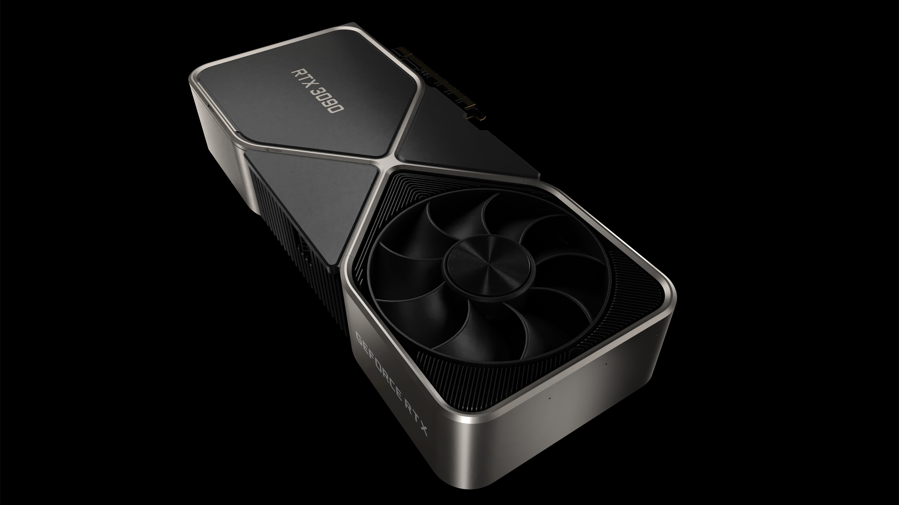
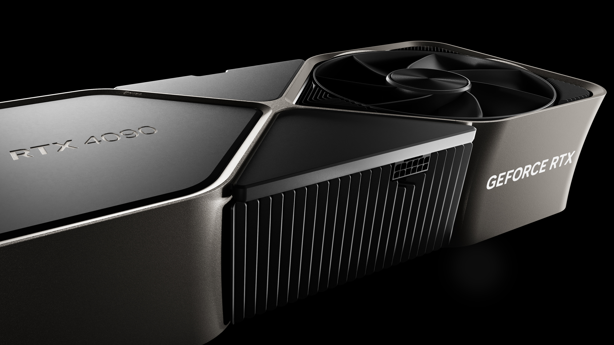
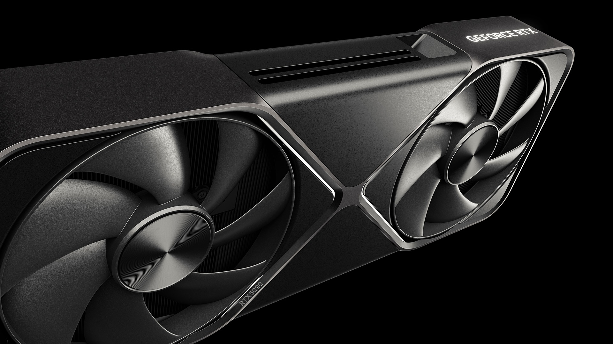
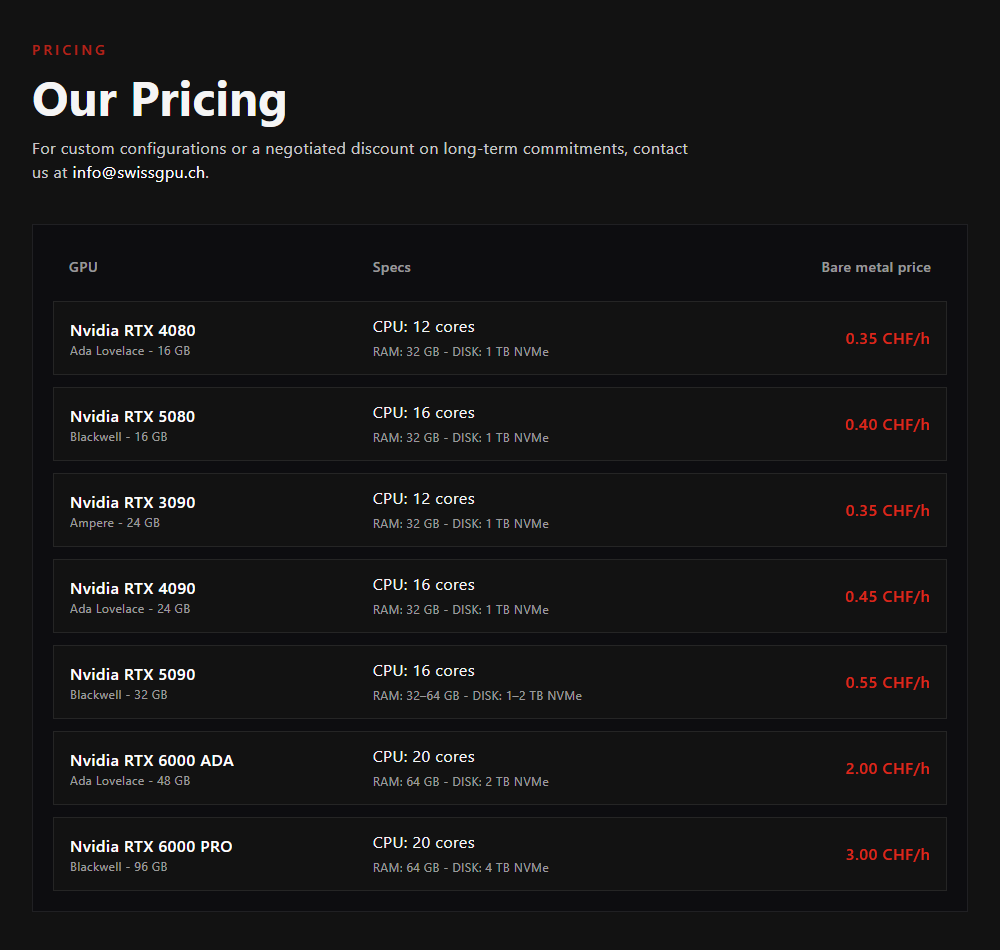
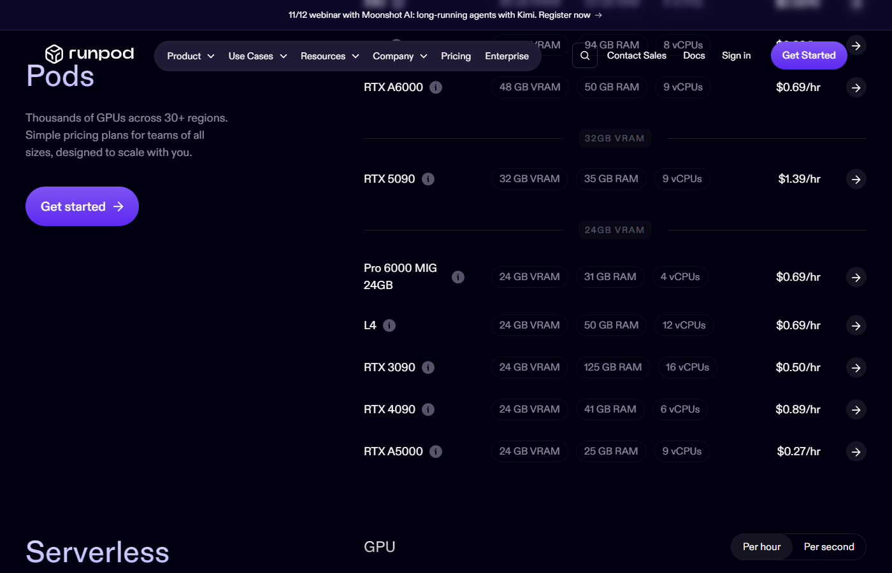
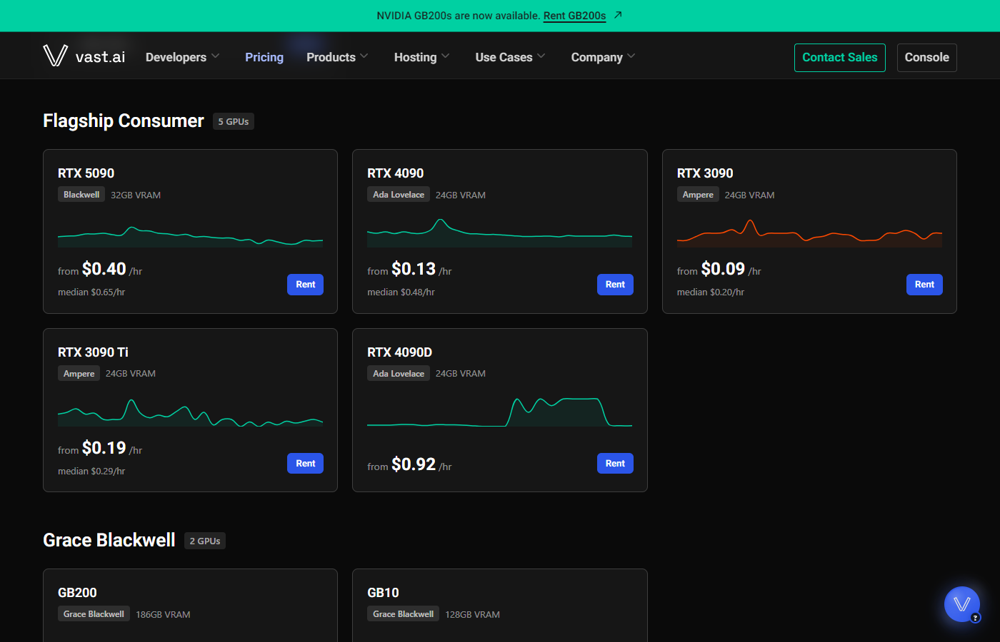

# Choix du GPU pour le projet DeepFake

**Tomas et Robin — 13 novembre 2026**

Nous avons choisi de **tester une RTX 5090 de 32 Go de VRAM en location chez SwissGPU** pour notre projet de transformation générative de la tête en direct par webcam.

## Le besoin

Nous voulons transformer **l’ensemble de la tête, y compris les cheveux**, avec une image crédible, des mouvements fluides et un délai faible. Le PC disponible possède une **RTX 4070 Laptop avec environ 8 Go de VRAM**.

**Nous avons testé Deep-Live-Cam sur notre PC.** Le traitement était trop lent pour une utilisation en temps réel : l’image saccadait, le retard était important et la qualité visuelle insuffisante. Le logiciel remplaçait uniquement le visage ; les cheveux et le reste de la tête restaient ceux de la personne filmée. Ce sont les résultats observés pendant notre essai, sans mesure chiffrée de débit ou de délai.

Deep-Live-Cam utilise bien des **modèles d’IA pour l’échange de visage**, mais le résultat obtenu ne correspond pas à la génération d’une tête complète que nous recherchons. Nous devons donc choisir un modèle adapté à cet objectif et tester une machine plus puissante. **Un meilleur GPU ne suffit pas à ajouter la transformation des cheveux à un outil limité à l’échange de visage.** [Documentation Deep-Live-Cam](https://github.com/hacksider/Deep-Live-Cam)

La **VRAM est la mémoire du GPU**. Les 32 à 64 Go de RAM annoncés pour le serveur SwissGPU sont une mémoire distincte. La RTX 5090 possède bien **32 Go de VRAM** ; cette capacité donne de la marge, sans garantir à elle seule la qualité ou la fluidité. [NVIDIA](https://www.nvidia.com/en-us/geforce/graphics-cards/50-series/rtx-5090/)

## Les options comparées

| Option | Notre choix |
|---|---|
| Garder le PC actuel | L’essai de Deep-Live-Cam était trop lent et de qualité insuffisante ; il sert de point de comparaison. |
| Emprunter un PC à l’école | Alternative intéressante si une machine adaptée est disponible. |
| Acheter une carte ou un PC | Investissement important avant de connaître le besoin réel ; une carte de bureau nécessite une machine compatible. |
| Louer une RTX 3090 ou 4090 | Moins cher à l’heure, avec 24 Go de VRAM. |
| **Louer une RTX 5090** | **Solution retenue pour les essais : 32 Go de VRAM et aucun achat de matériel.** |

| RTX 3090 — 24 Go | RTX 4090 — 24 Go | **RTX 5090 — 32 Go** |
|---|---|---|
|  |  |  |
| 0,35 CHF/h chez SwissGPU | 0,45 CHF/h chez SwissGPU | **0,55 CHF/h chez SwissGPU** |
| Crédit : NVIDIA. [Page produit](https://www.nvidia.com/en-us/geforce/graphics-cards/30-series/rtx-3090-3090ti/) · [Image originale](https://www.nvidia.com/content/dam/en-zz/Solutions/geforce/ampere/rtx-3090/geforce-rtx-3090-product-gallery-full-screen-3840-2.jpg) | Crédit : NVIDIA. [Page produit](https://www.nvidia.com/en-us/geforce/graphics-cards/40-series/rtx-4090/) · [Image originale](https://images.nvidia.com/aem-dam/Solutions/geforce/ada/rtx-4090/geforce-rtx-4090-product-gallery-full-screen-3840-3.jpg) | Crédit : NVIDIA. [Page produit](https://www.nvidia.com/en-us/geforce/graphics-cards/50-series/rtx-5090/) · [Image originale](https://www.nvidia.com/content/dam/en-zz/Solutions/geforce/graphic-cards/50-series/rtx-5090/geforce-rtx-5090-gallery-shot-3-ari.jpg) |

*Visuels constructeur ; le modèle installé dans le serveur peut différer. Tarifs hors électricité et frais : [API SwissGPU](https://www.swissgpu.ch/api/v1/pricing).*

## Pourquoi la RTX 5090 chez SwissGPU

Notre essai justifie de comparer une machine plus puissante. Les ralentissements observés ne permettent toutefois pas d’attribuer le problème à la seule VRAM : l’utilisation effective du GPU et les réglages devront aussi être vérifiés.

La RTX 5090 apporte **8 Go de VRAM supplémentaires pour 0,10 CHF/h de plus que la RTX 4090**. Sur 10 heures, cela représente **1 CHF supplémentaire de location**, hors différence de consommation électrique. Cet écart nous paraît raisonnable pour tester avec davantage de marge mémoire.

La location convient à un projet scolaire ponctuel : nous pouvons évaluer le matériel avant d’envisager un achat. SwissGPU propose des **serveurs dédiés en Suisse** et une facturation en CHF. La proximité est intéressante, mais le délai vidéo devra être mesuré depuis l’école. [SwissGPU](https://www.swissgpu.ch/about)

*Source : [SwissGPU — tarifs](https://www.swissgpu.ch/pricing), capture du 13 novembre 2026.*

**Runpod et Vast.ai** sont d’autres possibilités de location. Nous retenons SwissGPU pour ce premier test, sans affirmer qu’il est toujours le moins cher : les configurations, les frais et la localisation diffèrent.

| Runpod | Vast.ai |
|---|---|
|  |  |
| Source : [Runpod — tarifs](https://www.runpod.io/pricing). | Source : [Vast.ai — tarifs](https://vast.ai/pricing). |

*Captures du 13 novembre 2026 ; prix affichés en dollars américains.*

## Budget pour 10 heures

| Poste | Coût |
|---|---:|
| Location RTX 5090 : 10 × 0,55 CHF | **5,50 CHF** |
| Une installation Linux | **0,50 CHF** |
| Électricité | **0,32 CHF par kWh consommé** |
| **Total hors options** | **6,00 CHF + électricité** |

Si les **7,90 CHF affichés par SwissGPU concernent l’électricité seule**, le total serait **5,50 + 0,50 + 7,90 = 13,90 CHF**. Le détail de ce montant reste à confirmer avant la location. [Tarifs et frais](https://www.swissgpu.ch/pricing)

Il faut **libérer le serveur à la fin de la séance** : l’éteindre ne suffit pas à arrêter la facturation.

## Les essais prévus

Nous sélectionnerons d’abord une solution capable de **transformer la tête entière et les cheveux**, puis nous la testerons sur la RTX 5090 : qualité visuelle, images par seconde, délai d’affichage et stabilité. Une comparaison avec le PC actuel utilisera les mêmes modèles et réglages lorsque ceux-ci peuvent y fonctionner. La vidéo fera l’aller-retour entre la webcam de l’école et le serveur ; le délai réseau devra donc également être mesuré.

Nous demandons à l’école le financement de cette séance après confirmation du coût, ainsi que l’accès au réseau, à une webcam et à un écran. Les essais détermineront si nous conservons cette solution pour la présentation.

[Retour au projet](../README.md)
